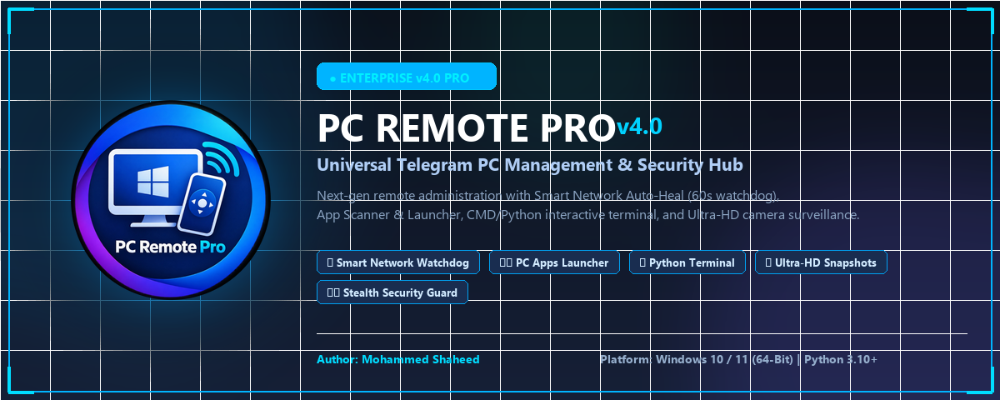
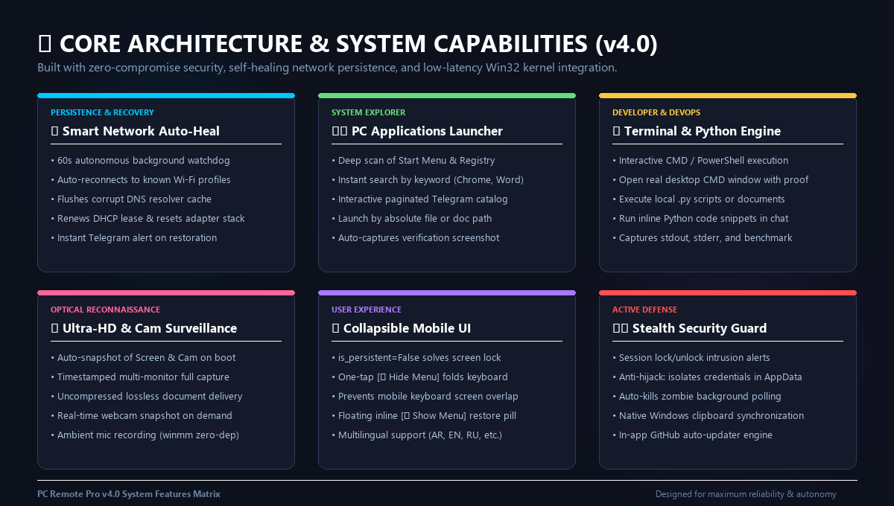
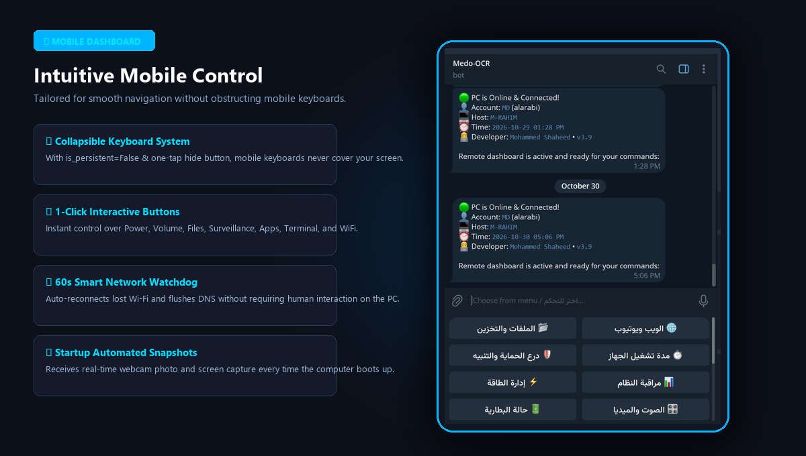
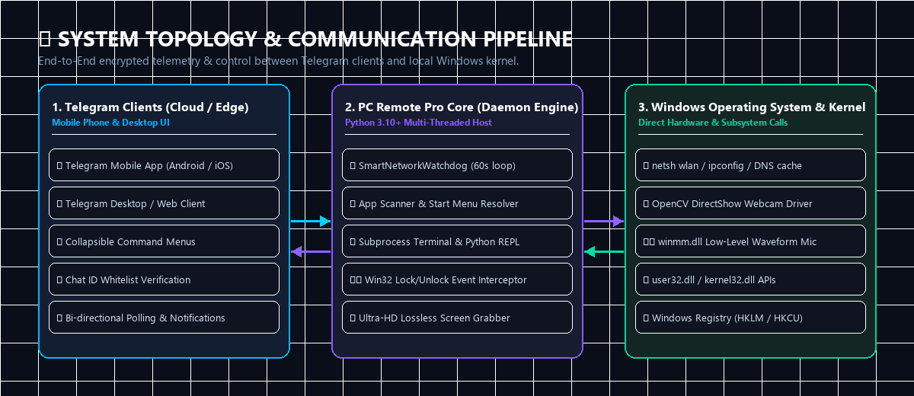

<div align="center">



# ⚡ PC Remote Pro (v4.0)

### *Enterprise-Grade Autonomous Telegram PC Remote Management & Security Hub*
**تحكم ذكي، إدارة شاملة للحاسبة عن بُعد، نظام حماية وصيانة ذاتي للشبكة عبر تيليجرام**

[](https://github.com/)
[-0078d4?style=for-the-badge&logo=windows)](https://microsoft.com/windows)
[](https://python.org)
[](https://core.telegram.org/bots/api)
[](LICENSE)

<p align="center">
  <a href="#-overview--نظرة-عامة">Overview</a> •
  <a href="#-whats-new-in-v40--الجديد-في-الإصدار-40">What's New in v4.0</a> •
  <a href="#-key-features--المميزات-الرئيسية">Key Features</a> •
  <a href="#-system-architecture--المعمارية">Architecture</a> •
  <a href="#-installation--setup--طريقة-التثبيت-والتشغيل">Installation</a> •
  <a href="#-bot-commands--أوامر-البوت">Bot Commands</a> •
  <a href="#-security-guard--نظام-الأمان">Security Guard</a> •
  <a href="#-author--المطور">Author</a>
</p>

---

</div>

## 📖 Overview | نظرة عامة

**PC Remote Pro v4.0** هو تطبيق حاسوبي متقدم مصمم للتحكم الكامل بجهاز الكمبيوتر وإدارته عن بُعد من أي مكان في العالم عبر بوت تيليجرام مشفر وخاص. يدمج التطبيق بين **أدوات إدارة النظام (DevOps & SysAdmin)**، **أنظمة المراقبة البصرية الحية (Surveillance)**، و**الأنظمة الذكية للصيانة الذاتية للشبكة (Autonomous Network Healing)**، مما يمنحك راحة بال تامة حتى أثناء غيابك عن الحاسوب.

**PC Remote Pro v4.0** is an enterprise-grade Windows background service and interactive remote administration dashboard powered by Telegram Bot API. It enables seamless bi-directional PC control, automated network healing, installed application discovery, terminal execution, live screen capture, and continuous hardware monitoring directly from your smartphone or desktop.

---

## 🌟 What's New in v4.0 | الجديد في الإصدار 4.0

<div align="center">
  
</div>

| الميزة الجديدة | الوصف التقني الفائق | Status |
| :--- | :--- | :---: |
| **🔽 Collapsible Mobile Menu** | طي وإخفاء قائمة الأزرار لتوفير مساحة شاشة الموبايل ومنع تداخل لوحة المفاتيح. | **Live** ✅ |
| **🌐 Smart Network Watchdog** | فحص تلقائي للإنترنت كل 60 ثانية وإعادة ربط شبكة الوايفاي وتنظيف الـ DNS ذاتياً. | **Live** ✅ |
| **🖥️ PC Applications Explorer** | فحص واكتشاف كافة برامج الكمبيوتر المثبتة، تصفحها بالصفحات والبحث عنها وتشغيلها. | **Live** ✅ |
| **📸 Verification Screenshots** | أخذ لقطة شاشة تلقائية فور فتح أي برنامج للتأكد من حالته ومظهره. | **Live** ✅ |
| **⚡ Terminal & Python Engine** | فتح نافذة CMD، تنفيذ أوامر النظام، تشغيل ملفات بايثون وبناء أكواد برمجية مباشرة. | **Live** ✅ |
| **📷 Automated Boot Snapshots** | إرسال لقطة شاشة وصورة كاميرا ويب بدقة فائقة تلقائياً عند أول إقلاع للكمبيوتر بالتوقيت الدقيق. | **Live** ✅ |

---

## 📱 Mobile Experience & Collapsible Keyboard | تجربة الموبايل وطي القائمة

<div align="center">
  
</div>

- **حل مشكلة حجب الشاشة:** تم ضبط إعدادات التيليجرام على `is_persistent: False` لتمكين تطبيق الموبايل من طي الأزرار بكل سلاسة.
- **زر الطي الفوري:** زر مخصص **`[ 🔽 طي وإخفاء القائمة ]`** يقوم بإزالة أزرار الرد (`ReplyKeyboardRemove`) ويستبدلها بزر شفاف `[ 📱 إظهار لوحة التحكم ]` لفتحها متى أردت.
- **تحكم متجاوب:** وصول كامل لكافة خصائص الحاسبة بأقل عدد من اللمسات.

---

## 🏗️ System Architecture | المعمارية التقنية

<div align="center">
  
</div>

يعمل النظام وفق معمارية متعددة الخيوط (`Multi-Threaded Architecture`) عالية الاستقرار:
1. **طبقة التيليجرام (Telegram Edge):** استقبال الأوامر من الهواتف والحواسب المصرح لها فقط عبر معرّف المحادثة (`Chat ID Whitelist`).
2. **نواة المحرك الداخلي (PC Remote Engine):**
   - حارس الشبكة الذاتي (`SmartNetworkWatchdog`) على مدار الساعة.
   - خيط مراقبة الحافظة وقص الشاشة المباشر (`ClipboardWatcher`).
   - خيط حارس الأمان لكشف محاولات فتح قفل الجلسة (`SecurityGuard`).
3. **طبقة نظام ويندوز (Windows Kernel & Hardware Interop):**
   - استدعاء مباشر لملفات `user32.dll` و `kernel32.dll` و `winmm.dll`.
   - إدارة واجهات الشبكة عبر `netsh wlan` و `ipconfig`.
   - محرك OpenCV DirectShow لكاميرات الويب عالية الدقة.

---

## 🚀 Key Features | المميزات بالتفصيل

### 🌐 1. نظام الفحص والصيانة الذاتي للشبكة (Smart Network Watchdog)
- فحص الاتصال بالإنترنت كل دقيقة (60 ثانية) على خوادم فائقة الاعتمادية عبر منفذ 443.
- عند انقطاع الاتصال المفاجئ والمستخدم غير متواجد:
  - فحص محول الوايفاي والبحث في قائمة الشبكات المحفوظة.
  - إعادة الربط التلقائي بأقوى شبكة معروفة (`netsh wlan connect`).
  - تفريغ ذاكرة الكاش التالفة للـ DNS (`ipconfig /flushdns`).
  - تجديد عنوان IP للاتصال عبر الراوتر (`ipconfig /renew`).
  - إرسال إشعار فوري على هاتفك عند نجاح الاستعادة.
- ميزة نبض الشبكة (`Heartbeat`): إشعار اختياري يُرسل كل دقيقة للتأكيد.

### 🖥️ 2. مركز تطبيقات وبرامج الكمبيوتر (PC Applications Center)
- فحص شامل لقائمة ابدأ (Start Menu) ومفتاح إلغاء التثبيت في الريجستري (`Uninstall Registry`).
- تصفح برامج الكمبيوتر في كتالوج مقسم لصفحات منظمة (8 برامج لكل صفحة).
- البحث الفوري عن أي تطبيق بالاسم (مثال: `chrome`, `word`, `excel`, `revit`, `telegram`, `autocad`).
- تشغيل التطبيقات والمستندات عبر المسار المباشر.
- التقاط لقطة شاشة تلقائية فائقة الوضوح بعد ثانيتين ونصف من التشغيل للتأكد من فتح البرنامج.

### ⚡ 3. موجه الأوامر ومحرك بايثون (CMD & Python Subsystem)
- تنفيذ أوامر موجه الأوامر واستلام المخرجات في كتل نصوص برمجية منسقة.
- فتح نافذة CMD مرئية على شاشة الكمبيوتر مع لقطة شاشة تثبت فتحها.
- تشغيل ملفات بايثون (`.py`) المحلية أو إرسال ملف سكربت في الشات لتشغيله مباشرة.
- كتابة أكواد بايثون وتجربتها في المحادثة مباشرة مع قياس زمن المعالجة بالثواني.

### 📸 4. المراقبة البصرية والصوتية (Visual & Audio Reconnaissance)
- التقاط لقطات شاشة Ultra-HD متعددة الشاشات وإرسالها كصورة ومستند أصلي غير مضغوط.
- التقاط صور حية من كاميرا الويب المدمجة أو الخارجية.
- تسجيل صوت المايكروفون المحيطي بجودة نقية لمدة تصل إلى 120 ثانية (عبر `winmm` بدون برامج خارجية).
- **صور الإقلاع التلقائية:** إرسال صورة الشاشة وكاميرا الويب فور إقلاع الكمبيوتر مصحوبة بالتوقيت الدقيق.

### ⚡ 5. إدارة الطاقة والملفات والوسائط
- إيقاف التشغيل، إعادة التشغيل، وضع السكون (Sleep)، إطفاء الشاشات، وقفل الحاسبة.
- ميزة إيقاظ الشاشة ونشاط الماوس (`Wake Up`).
- متصفح متقدم للملفات، التنزيلات، المستندات، محركات الأقراص، وفحص وإفراغ سلة المهملات.
- التحكم بمستوى الصوت، كتم الصوت، وتشغيل وإيقاف المقاطع والوسائط.
- تشغيل أي فيديو أو مقطع يوتيوب ببحث مباشر في نافذة واحدة مدمجة.

---

## 💻 Installation & Setup | طريقة التثبيت والتشغيل

### الطريقة الأولى: استخدام ملف التثبيت المجهز (موصى به)
1. حمّل ملف التثبيت المباشر:
   ```text
   PC_Remote_Pro_Setup_v4.0.exe
   ```
2. شغّل المثبت، واختر خيار **تشغيل التطبيق تلقائياً مع بدء تشغيل ويندوز (Startup)**.
3. ستفتح واجهة التطبيق الأنيقة المظلمة؛ الصق **Bot Token** الخاص بك من [@BotFather](https://t.me/BotFather) ومعرّف حسابك **Chat ID** من [@userinfobot](https://t.me/userinfobot).
4. اضغط **Save & Start** وسيبدأ البوت في العمل فوراً في شريط المهام (System Tray).

### الطريقة الثانية: التشغيل من الكود المصدري (Python)
```bash
# 1. استنساخ المستودع
git clone https://github.com/username/pc-remote-pro.git
cd pc-remote-pro

# 2. تثبيت الحزم والمتطلبات
pip install customtkinter pillow psutil python-telegram-bot pystray opencv-python

# 3. تشغيل التطبيق
python bot_control.py
```

---

## ⌨️ Bot Commands & Shortcuts | أوامر واختصارات البوت

| الأمر (Command) | الاختصار العربي | الوظيفة |
| :--- | :--- | :--- |
| `/start` أو `/menu` | `الرئيسية`, `menu` | فتح لوحة التحكم الرئيسية |
| `/hide` أو `/fold` | `طي`, `إخفاء` | طي وإخفاء قائمة الأزرار للموبايل |
| `/apps` | `برامج`, `تطبيقات` | مركز تصفح والبحث عن تطبيقات الكمبيوتر |
| `/cmd` أو `/py` | `اوامر`, `بايثون` | موجه الأوامر ومحرك تشغيل أكواد بايثون |
| `/heal` أو `/netheal` | `شبكة ذكية`, `اصلاح` | الفحص والصيانة الذاتية للشبكة |
| `/screen` | `سكرين`, `شاشة` | التقاط صورة فائقة الدقة للشاشة |
| `/webcam` | `كاميرا`, `كام` | التقاط صورة فورية من كاميرا الويب |
| `/mic` | `تسجيل`, `صوت` | تسجيل صوتي من مايكروفون الكمبيوتر |
| `/specs` | `مواصفات`, `عتاد` | تقرير مفصل بمواصفات المعالج والرام والكرت |
| `/wifi` | `وايفاي`, `شبكة` | تشخيص الاتصال بالشبكة ومعلومات الراوتر |
| `/wifipass` | `باسورد`, `كلمات السر` | استخراج كلمات سر شبكات الوايفاي المحفوظة |
| `/guard` | `حماية`, `درع` | لوحة درع الحماية والمراقبة الأمنية |
| `/uptime` | `مدة التشغيل` | تقرير بالوقت المنقضي منذ تشغيل الحاسبة |
| `/wake` | `إيقاظ` | إيقاظ شاشة الكمبيوتر وتنبيه النظام |
| `/battery` | `بطارية` | فحص نسبة شحن وحالة بطارية اللابتوب |
| `/kill` | `انهاء` | قائمة بأثقل العمليات وإمكانية إغلاقها |
| `/update` | `تحديث` | فحص وتثبيت التحديثات من GitHub |

---

## 🛡️ Security Guard & Privacy | نظام الأمان والخصوصية

- **عزل المفاتيح المشفر:** تُحفظ الإعدادات والمفاتيح داخل مجلد `%LOCALAPPDATA%\PCRemotePro` لضمان عدم مشاركة الاعتمادات أو تسريبها عند نسخ المجلد لجهاز آخر.
- **جدار حماية المستخدم (ID Whitelist):** أي محاولة تواصل مع البوت من شخص غير مصرح له تُرفض فوراً مع إرسال تنبيه أمني لك يحتوي على معرّف المحاول.
- **كشف الدخلاء والتنبيه:** عند قفل شاشة الويندوز أو محاولة فك القفل في غيابك، يلتقط النظام صورة للشاشة وكاميرا الويب ويرسلها فوراً لهاتفك.
- **مكافحة العمليات العالقة (Anti-Zombie):** فحص وقتي لمنع تكرار النسخ في الخلفية وضمان عدم تداخل جلسات الـ Polling.

---

## 👨‍💻 Author & Maintainer | المطور

- **Project Lead & Developer:** **Mohammed Shaheed**
- **Version:** **v4.0.0 Enterprise Edition**
- **Technologies:** Python 3.14 / CustomTkinter / Win32 Kernel APIs / AsyncIO / OpenCV / PTB

---

<div align="center">

*PC Remote Pro v4.0 is engineered with precision for peak remote resilience and ultimate autonomy.*

⭐ **إذا أعجبك المشروع، لا تنسَ دعمه بنجمة (Star) على GitHub!** ⭐

</div>

