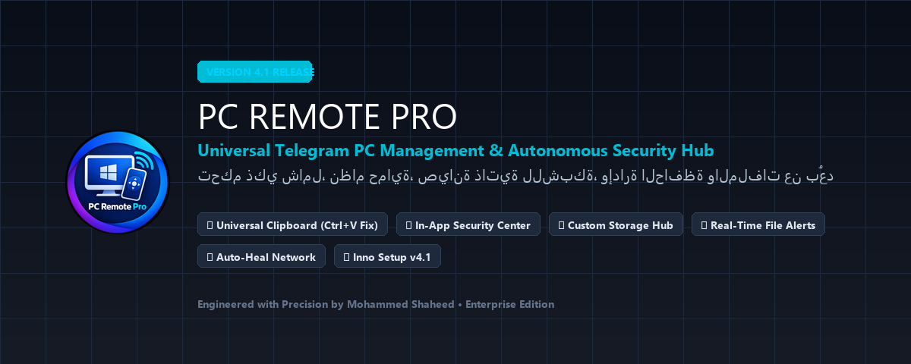
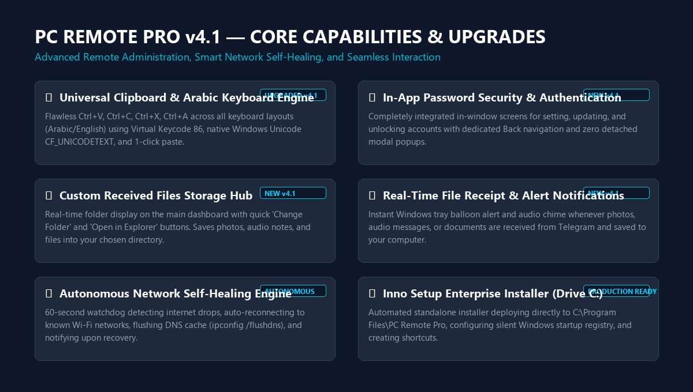
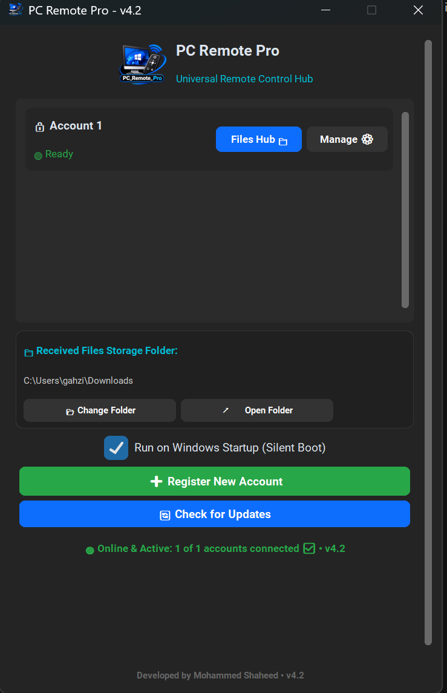
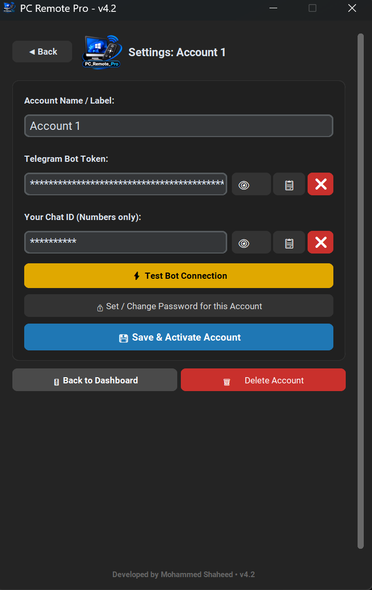
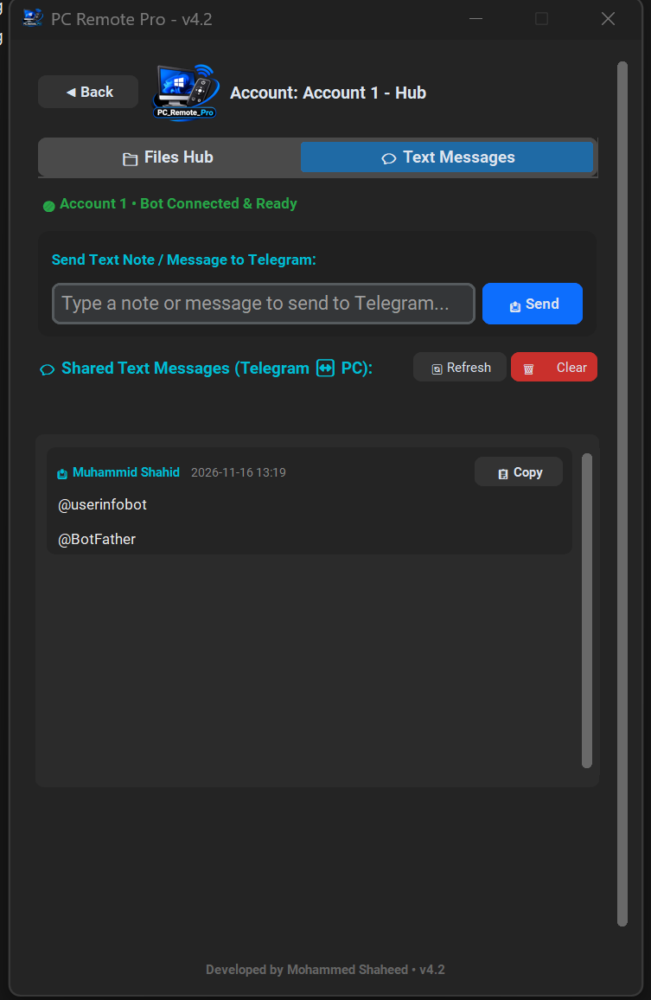
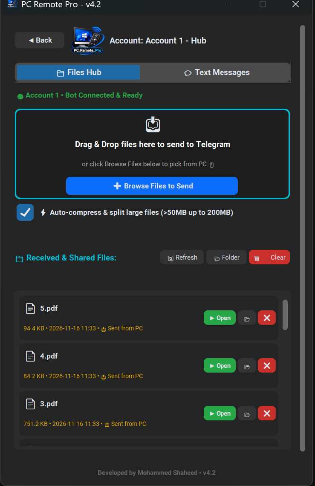
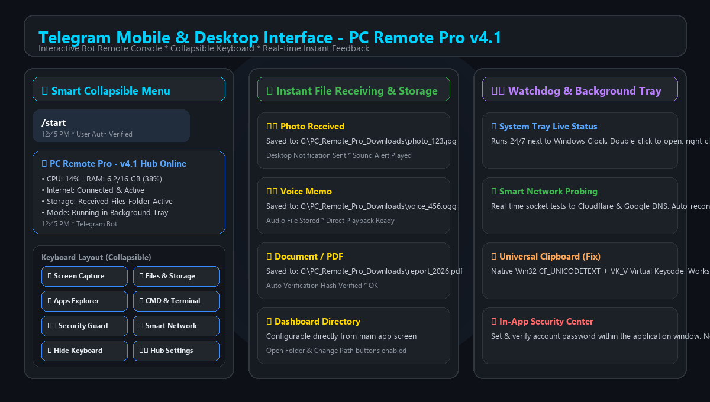
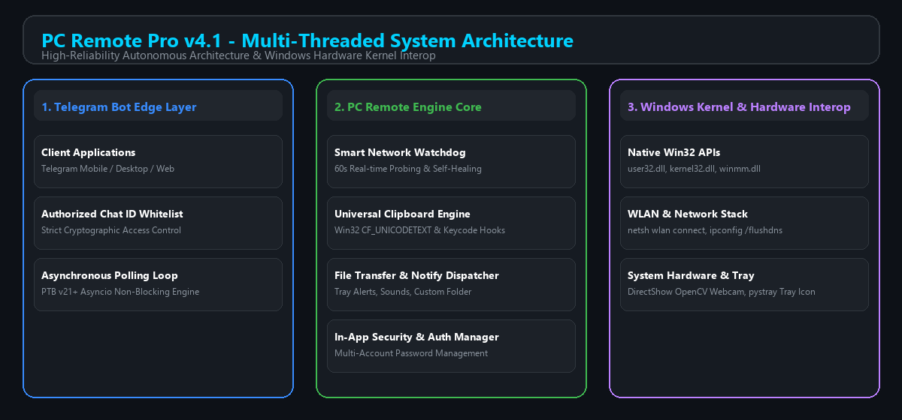

<div align="center">



# ⚡ PC Remote Pro (v4.2 Final)

### *Enterprise-Grade Autonomous Telegram PC Remote Management & Security Hub*
**تحكم ذكي، إدارة شاملة للحاسبة عن بُعد، نظام حماية وصيانة ذاتي للشبكة ونقل ملفات حتى 200MB عبر تيليجرام**

[](https://github.com/moshraheem-sudo/PC_Remote_Pro/releases)
[-0078d4?style=for-the-badge&logo=windows)](https://microsoft.com/windows)
[](https://python.org)
[](https://core.telegram.org/bots/api)
[](https://github.com/moshraheem-sudo/PC_Remote_Pro)

<p align="center">
  <a href="#-overview--نظرة-عامة">Overview</a> •
  <a href="#-whats-new-in-v42--الجديد-في-الإصدار-42">What's New in v4.2</a> •
  <a href="#-interactive-setup-guide--دليل-الضبط-والتعليمات">Setup Guide</a> •
  <a href="#-key-features--المميزات-الرئيسية">Key Features</a> •
  <a href="#-system-architecture--المعمارية">Architecture</a> •
  <a href="#-installation--setup--طريقة-التثبيت-والتشغيل">Installation</a> •
  <a href="#-bot-commands--أوامر-البوت">Bot Commands</a> •
  <a href="#-author--المطور">Author</a>
</p>

---

</div>

## 📖 Overview | نظرة عامة

**PC Remote Pro v4.2** هو تطبيق ويندوز متقدم مصمم للتحكم الكامل بجهاز الكمبيوتر وإدارته عن بُعد من أي مكان في العالم عبر بوت تيليجرام مشفر وخاص. يدمج التطبيق بين **أدوات إدارة النظام (DevOps & SysAdmin)**، **أنظمة المراقبة البصرية الحية (Surveillance)**، و**الأنظمة الذكية لمشاركة الملفات الضخمة حتى 200 ميجابايت مع التجزئة والدمج التلقائي**، مع تشغيل خفيف ومستقر في خلفية النظام (System Tray قرب الساعة).

**PC Remote Pro v4.2** is an enterprise-grade Windows background service and interactive remote administration dashboard powered by Telegram Bot API. It enables seamless bi-directional PC control, automated network healing, 200MB large-file transfer with streaming and auto-recombination, built-in interactive setup guide with direct links to [@BotFather](https://t.me/BotFather) and [@userinfobot](https://t.me/userinfobot), separate Files & Settings Hubs, in-app password vault, live screen capture, and continuous hardware surveillance directly from your smartphone or desktop.

---

## 🌟 What's New in v4.2 | الجديد في الإصدار 4.2

<div align="center">
  
</div>

| الميزة الجديدة في v4.2 | الوصف التقني الفائق | الحالة |
| :--- | :--- | :---: |
| **🛡️ Built-in MTProto Proxy Manager** | مدير بروكسي MTProto مدمج يدعم السيرفر والمنفذ والمفتاح مع فحص مباشر لسرعة الاستجابة بالمللي ثانية (Ping Latency)، وتعبئة تلقائية، وفتح التيليجرام بضغطة زر ورابط مباشر لقناة [@ProxyMTProto](https://t.me/ProxyMTProto). | **مكتمل ومفعل** ✅ |
| **ℹ️ Interactive In-App Setup Guide** | شاشة إرشادات متكاملة بنقاط واضحة بالإنجليزية مع أزرار مباشرة لفتح [@BotFather](https://t.me/BotFather) و [@userinfobot](https://t.me/userinfobot) في تيليجرام لجلب التوكن والـ Chat ID فوراً. | **مكتمل ومفعل** ✅ |
| **📁 Separated Files Hub & Real-time Text Hub** | فصل شاشة الإعدادات (`Manage ⚙️`) عن مركز الملفات والرسائل (`Files Hub 📁`) مع دعم السحب والإفلات (Drag & Drop) والنسخ اللحظي إلى الحافظة. | **مكتمل ومفعل** ✅ |
| **⚡ 200MB File Transfers with Auto-Split** | رفع الحد الأقصى للملفات إلى 200 ميجابايت مع تجزئة الملفات الكبيرة تلقائياً وضغطها ودعم البث المباشر حتى 600 ثانية لمنع انتهاء المهلة. | **مكتمل ومفعل** ✅ |
| **🗑️ Transfer History Management** | زر حذف سجل الملفات المرسلة والمستلمة (`🗑️ Clear`) مع إشعار مدمج داخل التطبيق دون نوافذ منبثقة مزعجة. | **مكتمل ومفعل** ✅ |
| **🎨 Ultra-Crisp Windows 11 Taskbar Icon** | أيقونة أصلية متعددة الدقات (9 طبقات حتى 256x256) مع ربط مباشر عبر Win32 API (`SendMessageW`) لعرض حاد وواضح 100% على شاشات High-DPI. | **مكتمل ومفعل** ✅ |
| **🔒 Isolated AppData Storage** | حفظ آمن لمعلومات الحسابات والتخزين المؤقت في `%LOCALAPPDATA%\PCRemotePro` لعزل الإعدادات ومنع تضارب البيانات عند نقل المجلد. | **مكتمل ومفعل** ✅ |

---

## 🔑 Interactive Setup Guide | دليل الضبط السريع

<div align="center">
  <table>
    <tr>
      <td align="center"><br/><b>Dashboard (Main)</b></td>
      <td align="center"><br/><b>Account Settings</b></td>
      <td align="center"><br/><b>Files Hub (200MB)</b></td>
      <td align="center"><br/><b>Text Messages</b></td>
    </tr>
  </table>
</div>

To connect your PC to Telegram, you need two credentials:
1. **Telegram Bot Token**: Created via [@BotFather](https://t.me/BotFather) (`/newbot`).
2. **Personal Chat ID**: Retrieved via [@userinfobot](https://t.me/userinfobot) (send `/start`).

Inside the application, click the **`🛡️ Proxy`** button to configure MTProto proxies with live latency testing and direct Telegram activation, or view step-by-step bot configuration with direct links to [@BotFather](https://t.me/BotFather) and [@userinfobot](https://t.me/userinfobot). Also find latest free proxies directly from [@ProxyMTProto](https://t.me/ProxyMTProto).

---

## 📱 Mobile Experience & Collapsible Keyboard | تجربة الموبايل وواجهة البوت

<div align="center">
  
</div>

- **حل مشكلة حجب الشاشة:** تم ضبط إعدادات التيليجرام على `is_persistent: False` لتمكين تطبيق الموبايل من طي الأزرار بكل سلاسة.
- **زر الطي الفوري:** زر مخصص **`[ 🔽 طي وإخفاء القائمة ]`** يقوم بإزالة أزرار الرد (`ReplyKeyboardRemove`) ويستبدلها بزر شفاف `[ 📱 إظهار لوحة التحكم ]` لفتحها متى أردت.
- **تنبيهات الملفات اللحظية:** عند إرسال أي صورة أو ملف أو تسجيل صوتي من هاتفك، يتم حفظه فوراً في مجلدك المخصص مع تشغيل نغمة تنبيه وإشعار Tray على الحاسوب.

---

## 🏗️ System Architecture | المعمارية التقنية

<div align="center">
  
</div>

يعمل النظام وفق معمارية متعددة الخيوط (`Multi-Threaded Architecture`) عالية الاستقرار:
1. **طبقة التيليجرام (Telegram Edge):** استقبال الأوامر من الهواتف والحواسب المصرح لها فقط عبر معرّف المحادثة (`Chat ID Whitelist`).
2. **نواة المحرك الداخلي (PC Remote Engine Core):**
   - حارس الشبكة الذاتي والمشرف الحقيقي (`Smart Network Watchdog & Tray Supervisor`).
   - معالج الحافظة الشامل (`Universal Clipboard Handler`) لدعم اللصق والنسخ مع كافة اللغات وتخطيطات المفاتيح.
   - مدير الملفات والتنزيلات والإشعارات الصوتية والمكتبية.
   - مركز إدارة وتأكيد كلمات المرور المدمج (`In-App Password Security Center`).
3. **طبقة نظام ويندوز (Windows Kernel & Hardware Interop):**
   - استدعاء مباشر لملفات `user32.dll` و `kernel32.dll` و `winmm.dll`.
   - إدارة واجهات الشبكة عبر `netsh wlan` و `ipconfig`.
   - محرك OpenCV DirectShow لكاميرات الويب عالية الدقة.

---

## 🚀 Key Features | المميزات بالتفصيل

### 📋 1. معالجة النسخ واللصق الشاملة (Universal Clipboard Engine)
- دعم كامل للصق عبر زر اللصق (📋) وعبر اختصار لوحة المفاتيح `Ctrl+V` و `Ctrl+C` و `Ctrl+X` و `Ctrl+A`.
- توافق تام مع تخطيط لوحة المفاتيح العربية، حيث يتم اعتراض المفتاح الفعلي عبر الـ Virtual Keycode (`VK_V = 86`).
- قراءة مباشرة للبيانات النصية من الحافظة عبر استدعاء Win32 API بصيغة `CF_UNICODETEXT (13)` مع دعم احتياطي فوري لمكتبة Tkinter و PowerShell.

### 📁 2. مجلد مخصص وتنبيهات فورية للملفات المستلمة
- إظهار مسار مجلد حفظ الملفات المستلمة مباشرة في الواجهة الرئيسية.
- زران مخصصان لتغيير مسار المجلد واختيار أي مسار على القرص، وزر لفتح المجلد مباشرة في مستكشف ويندوز.
- توجيه كافة الصور والمستندات والتسجيلات الصوتية المرسلة للبوت تلقائياً إلى هذا المجلد.
- إصدار نغمة تنبيه صوتية نظامية وإشعار بالبالون في صينية النظام (System Tray) عند اكتمال تحميل أي ملف.

### 🔐 3. مركز إدارة كلمات المرور المدمج (In-App Password Vault)
- إلغاء النوافذ المنبثقة المستقلة واستبدالها بواجهات مدمجة أنيقة داخل نافذة التطبيق نفسه.
- واجهة مخصصة لإنشاء وتأكيد كلمة المرور مع زر الرجوع للخلف والحفظ التلقائي والعودة.
- واجهة تحقق أنيقة عند فتح الحسابات المقفلة بدون أي مشاكل في التركيز أو النوافذ العائمة.

### 🌐 4. نظام الفحص والصيانة الذاتي للشبكة (Smart Network Watchdog)
- فحص دوري حقيقي للاتصال بالإنترنت كل دقيقة عبر اتصالات Socket مشفرة على المنفذ 443 لخوادم موثوقة.
- إعادة الربط التلقائي بأقوى شبكة واي فاي معروفة (`netsh wlan connect`).
- تنظيف ذاكرة التخزين المؤقت للـ DNS (`ipconfig /flushdns`) وتجديد الـ IP عند انقطاع الاتصال.
- مراقبة حالة البوت بصورة حية وتحديث أيقونة شريط المهام بالوقت الفعلي.

### 🖥️ 5. مركز تطبيقات وبرامج الكمبيوتر (PC Applications Center)
- فحص شامل لقائمة ابدأ (Start Menu) ومفتاح إلغاء التثبيت في الريجستري (`Uninstall Registry`).
- تصفح برامج الكمبيوتر في كتالوج مقسم لصفحات منظمة (8 برامج لكل صفحة).
- البحث الفوري عن أي تطبيق بالاسم (مثال: `chrome`, `word`, `excel`, `revit`, `telegram`, `autocad`).
- تشغيل التطبيقات والمستندات مع لقطة شاشة تأكيدية تلقائية بعد فتح التطبيق.

### ⚡ 6. موجه الأوامر ومحرك بايثون (CMD & Python Subsystem)
- تنفيذ أوامر موجه الأوامر واستلام المخرجات في كتل نصوص برمجية منسقة.
- فتح نافذة CMD مرئية على شاشة الكمبيوتر مع لقطة شاشة تثبت فتحها.
- تشغيل ملفات بايثون (`.py`) المحلية أو إرسال ملف سكربت في الشات لتشغيله مباشرة.
- كتابة أكواد بايثون وتجربتها في المحادثة مباشرة مع قياس زمن المعالجة بالثواني.

### 📸 7. المراقبة البصرية والصوتية (Visual & Audio Reconnaissance)
- التقاط لقطات شاشة Ultra-HD متعددة الشاشات وإرسالها كصورة ومستند أصلي غير مضغوط.
- التقاط صور حية من كاميرا الويب المدمجة أو الخارجية.
- تسجيل صوت المايكروفون المحيطي بجودة نقية لمدة تصل إلى 120 ثانية.
- إرسال لقطات شاشة وكاميرا فورية عند إقلاع الجهاز ومحاولات تسجيل الدخول.

---

## 💻 Installation & Setup | طريقة التثبيت والتشغيل

### الطريقة الأولى: استخدام مثبت Inno Setup الجاهز (موصى به)
1. حمّل ملف التثبيت المباشر من صفحة الـ Releases:
   ```text
   PC_Remote_Pro_Setup_v4.1.exe
   ```
2. شغّل المثبت وسيتم تثبيت البرنامج تلقائياً في مساره الاحترافي:
   ```text
   C:\Program Files\PC Remote Pro
   ```
3. اختر خيار إنشاء اختصار سطح المكتب وتشغيل التطبيق تلقائياً مع ويندوز (Startup).
4. بعد التشغيل، الصق الـ **Bot Token** ومعرّف حسابك **Chat ID** ثم اضغط **Save & Start** وسيعمل فوراً في شريط المهام قرب الساعة.

### الطريقة الثانية: التشغيل من الكود المصدري (Python)
```bash
# 1. استنساخ المستودع
git clone https://github.com/moshraheem-sudo/PC_Remote_Pro.git
cd PC_Remote_Pro

# 2. تثبيت الحزم والمتطلبات
pip install customtkinter pillow psutil python-telegram-bot pystray opencv-python

# 3. تشغيل التطبيق
python bot_control.py
```

---

## ⌨️ Bot Commands & Shortcuts | أوامر واختصارات البوت

| الأمر (Command) | الاختصار العربي | الوظيفة |
| :--- | :--- | :--- |
| `/start` أو `/menu` | `الرئيسية`, `menu` | فتح لوحة التحكم الرئيسية للبوت |
| `/hide` أو `/fold` | `طي`, `إخفاء` | طي وإخفاء قائمة الأزرار للموبايل |
| `/apps` | `برامج`, `تطبيقات` | مركز تصفح والبحث عن تطبيقات الكمبيوتر |
| `/cmd` أو `/py` | `اوامر`, `بايثون` | موجه الأوامر ومحرك تشغيل أكواد بايثون |
| `/heal` أو `/netheal` | `شبكة ذكية`, `اصلاح` | الفحص والصيانة الذاتية للشبكة |
| `/screen` | `سكرين`, `شاشة` | التقاط صورة فائقة الدقة للشاشة |
| `/webcam` | `كاميرا`, `كام` | التقاط صورة فورية من كاميرا الويب |
| `/mic` | `تسجيل`, `صوت` | تسجيل صوتي من مايكروفون الكمبيوتر |
| `/specs` | `مواصفات`, `عتاد` | تقرير مفصل بمواصفات المعالج والرام والكرت |
| `/wifi` | `وايفاي`, `شبكة` | تشخيص الاتصال بالشبكة ومعلومات الراوتر |
| `/wifipass` | `باسورد`, `كلمات السر` | استخراج كلمات سر شبكات الوايفاي المحفوظة |
| `/guard` | `حماية`, `درع` | لوحة درع الحماية والمراقبة الأمنية |
| `/uptime` | `مدة التشغيل` | تقرير بالوقت المنقضي منذ تشغيل الحاسبة |
| `/wake` | `إيقاظ` | إيقاظ شاشة الكمبيوتر وتنبيه النظام |
| `/battery` | `بطارية` | فحص نسبة شحن وحالة بطارية اللابتوب |
| `/kill` | `انهاء` | قائمة بأثقل العمليات وإمكانية إغلاقها |
| `/update` | `تحديث` | فحص وتثبيت التحديثات من GitHub |

---

## 🛡️ Security Guard & Privacy | نظام الأمان والخصوصية

- **عزل المفاتيح المشفر:** تُحفظ الإعدادات والمفاتيح داخل مجلد `%LOCALAPPDATA%\PCRemotePro` لضمان عدم مشاركة الاعتمادات أو تسريبها عند نسخ المجلد لجهاز آخر.
- **جدار حماية المستخدم (ID Whitelist):** أي محاولة تواصل مع البوت من شخص غير مصرح له تُرفض فوراً مع إرسال تنبيه أمني لك يحتوي على معرّف المحاول.
- **كشف الدخلاء والتنبيه:** عند قفل شاشة الويندوز أو محاولة فك القفل في غيابك، يلتقط النظام صورة للشاشة وكاميرا الويب ويرسلها فوراً لهاتفك.
- **مكافحة العمليات العالقة (Anti-Zombie):** فحص وقتي لمنع تكرار النسخ في الخلفية وضمان عدم تداخل جلسات الـ Polling.

---

## 👨‍💻 Author & Maintainer | المطور

- **Project Lead & Developer:** **Mohammed Shaheed** ([@moshraheem-sudo](https://github.com/moshraheem-sudo))
- **Repository:** [moshraheem-sudo/PC_Remote_Pro](https://github.com/moshraheem-sudo/PC_Remote_Pro)
- **Version:** **v4.1.0 Enterprise Edition**
- **Technologies:** Python 3.12 / CustomTkinter / Win32 Kernel APIs / AsyncIO / OpenCV / PTB

---

<div align="center">

*PC Remote Pro v4.1 is engineered with precision for peak remote resilience and ultimate autonomy.*

⭐ **إذا أعجبك المشروع، لا تنسَ دعمه بنجمة (Star) على GitHub!** ⭐

</div>
